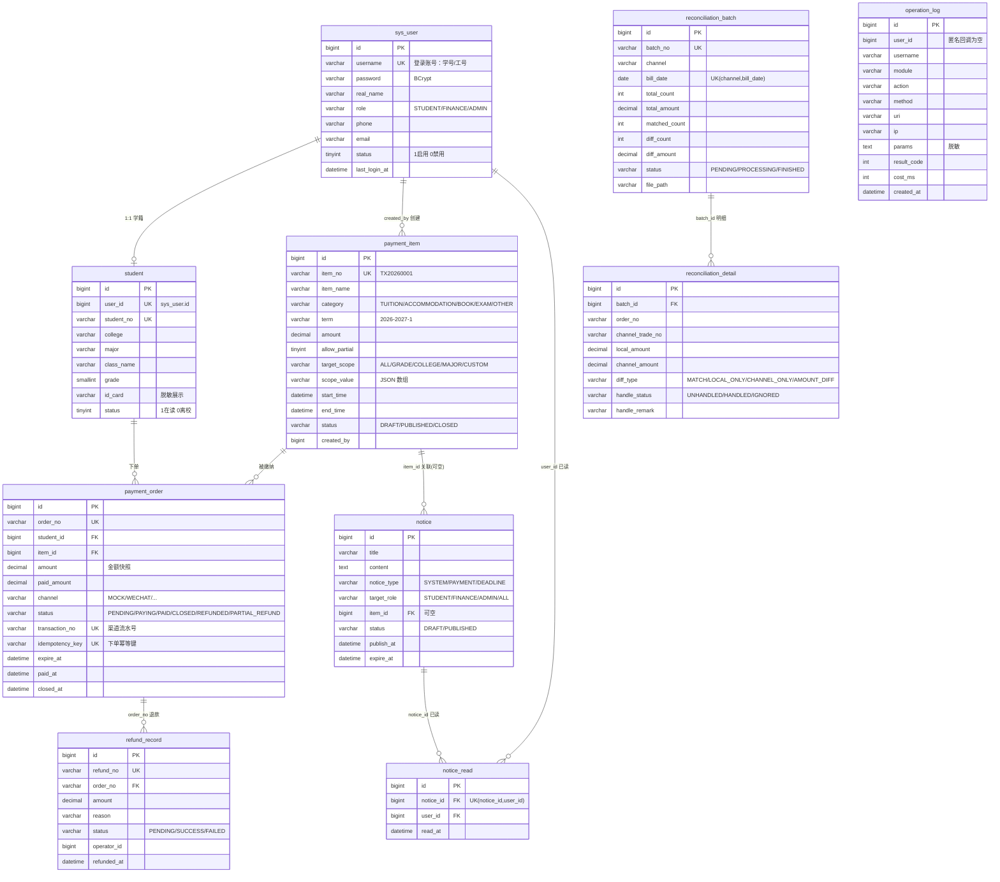

# 数据库 ER 说明

> README 5 章约定 `docs/er.png`，当前以 **mermaid 源码**形式维护（便于随代码评审同步修改）。
> 用支持 mermaid 的编辑器（VS Code 插件 / Typora / mermaid.live）可一键导出 PNG 覆盖 `docs/er.png`。

## 1. ER 图（mermaid）



## 2. 索引与唯一约束（幂等与一致性的关键）

| 表 | 约束 | 作用 |
|---|---|---|
| `sys_user` | `uk_username` | 账号唯一 |
| `student` | `uk_user_id`、`uk_student_no` | 一账号一学籍、学号唯一 |
| `payment_item` | `uk_item_no`、`idx_status_end(status,end_time)` | 项目号唯一；学生端可缴列表走该索引 |
| `payment_order` | `uk_order_no` | 订单号唯一 |
| `payment_order` | `uk_transaction_no` | **渠道流水号唯一**：同一笔渠道交易不能落到两个订单（重复支付 → `60003`） |
| `payment_order` | `uk_idempotency` | **下单幂等**：同一 `Idempotency-Key` 并发插入只会成功一次 |
| `payment_order` | `idx_student_status`、`idx_item_status`、`idx_paid_at` | 学生订单列表、按项目统计、按支付时间对账 |
| `refund_record` | `uk_refund_no`、`idx_order_no` | 退款单唯一、按订单查退款 |
| `reconciliation_batch` | `uk_batch_no`、`uk_channel_date` | 同渠道同账单日只允许一个批次（`60009`） |
| `notice_read` | `uk_notice_user` | 已读记录天然幂等（重复插入被吞掉） |

## 3. 状态机

```
payment_item:  DRAFT ──publish──> PUBLISHED ──close──> CLOSED
                   └──(仅 DRAFT 可编辑)──┘

payment_order: PENDING ──pay──> PAYING ──callback OK──> PAID
                  │                │                     │
                  │                └──callback FAIL──> 回退 PENDING
                  ├──close/超时──> CLOSED
                  └──PAID ──部分退款──> PARTIAL_REFUND ──退完──> REFUNDED
                       └──全额退款──> REFUNDED

refund_record: PENDING ──渠道成功──> SUCCESS ／ ──渠道失败──> FAILED

reconciliation_batch: PENDING ──match──> （有差异）PROCESSING ──全部核销──> FINISHED
                                        （无差异）直接 FINISHED
```

## 4. 数据初始化（`data.sql`）

| 账号 | 密码 | 角色 | 姓名 |
|---|---|---|---|
| `admin` | `123456` | ADMIN | 系统管理员 |
| `caiwu01` | `123456` | FINANCE | 张财务 |
| `20230101` | `123456` | STUDENT | 李小明（计算机学院/软件工程/2023） |
| `20230102` | `123456` | STUDENT | 王小红（外国语学院/英语/2023） |

预置 2 个缴费项目：

| 项目号 | 名称 | 金额 | 适用范围 | 分次缴费 |
|---|---|---|---|---|
| `TX20260001` | 2026-2027 学年学费 | 5800.00 | `ALL` 全体 | 否 |
| `SFF20260001` | 2026-2027 学年住宿费 | 1200.00 | `COLLEGE` 计算机学院、外国语学院 | 是 |

> BCrypt 密文：`$2a$10$N.zmdr9k7uOCQb376NoUnuTJ8iAt6Z5EHsM8lE9lBOsl7iKTVKIUi`（对应明文 `123456`）。
> 如需重新生成：运行 `backend/src/test/java/com/campus/payment/PasswordHashGenerator.java`（README 7.4）。
